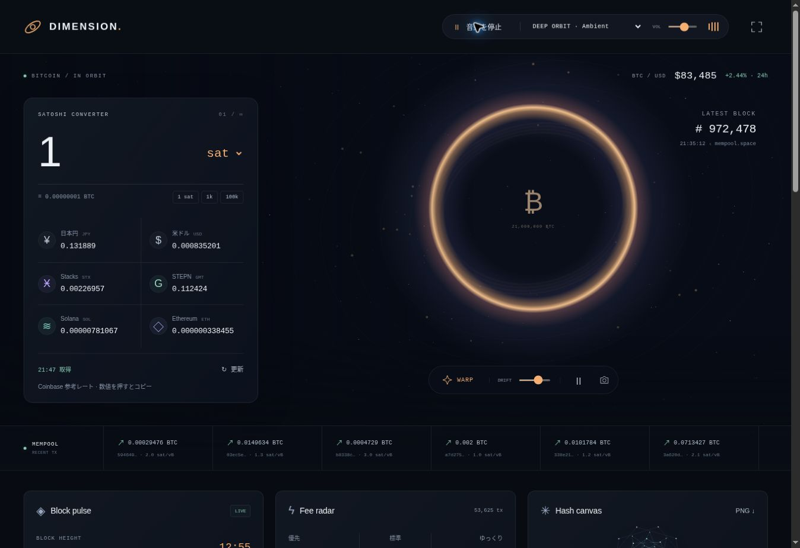

# DIMENSION

[サイトを開く](https://pythonddd.github.io/dimension/) · [English](README.md)

Bitcoin、宇宙、アンビエント、4つのゲームを1ページにまとめたサイトです。タブやモーダルを使わず、その場で操作できます。



## 主な機能

- **Satoshiコンバーター**：1 satからJPY・USD・STX・GMT・SOL・ETHを同時に換算。BTCを含む逆換算、プリセット、コピー、更新ボタンもあります。スマホでも最上部に表示します。
- **音楽**：56 BPMの「Deep Orbit」と68 BPMの「Blue Hour」。8小節のコード進行、柔らかい鍵盤音、ベース、ステレオの残響を組み合わせたオリジナル曲です。上部の再生ボタンで開始し、曲調と音量を選べます。
- **宇宙**：浮遊する星空、ワープ、動きの停止、画像保存、宇宙だけを眺めるモード。新しいBitcoinブロックで光の波が広がります。
- **Block pulse / Fee radar**：最新ブロック、未承認取引、手数料と日本円の概算を表示します。
- **Hash canvas**：ブロックハッシュや入力文字のSHA-256から幾何学模様を作り、PNGで保存。文字の処理は端末内で完結します。

## 4つのゲーム

| ゲーム | 遊び方 |
| --- | --- |
| Hash Echo | 光った順を再現する12ラウンドの記憶ゲーム。以前の最高得点も引き継ぎます。 |
| Sats Merge | 同じ数字を合体して2048を目指すパズル。スワイプ・矢印キー・画面のボタン、1手戻す操作に対応。 |
| Block Breaker | パドルでボールを跳ね返すブロック崩し。3ライフ、レベル進行、コンボ、パドル拡大。 |
| Chain Match | 隣同士を入れ替えて同じコインを3つ揃えるパズル。20手、連鎖、ヒント、詰み時の盤面再生成。 |

スコアはゲーム内だけのポイントで、最高得点をこの端末に保存します。Hash EchoとBlock Breakerは画面外・フォーカス喪失・タブ非表示で一時停止します。Hash Echoの音は音楽再生中に有効になり、チェックボックスで切れます。

旧3ゲーム、クリプトラボ、2017タイムマシン、シーン切替タブ、各種ダイアログは削除しました。

## データ

換算はCoinbaseの公開為替API、BTC/USDの日次変動はCoinbase Exchange、ブロックと手数料はmempool.spaceを参照します。換算は参考レートです。通常60秒ごとに取得し、ブロックはWebSocketでも受信します。保存値・接続待ち・取得不能を明示し、欠損したレートをゼロで埋めません。

## 開発・確認

Node 20以上。実行時の追加ライブラリ、APIキー、Secrets、ウォレット接続は不要です。GitHub Pagesのmainブランチ直下で動きます。

```sh
npm test
npm run check
npm run build
```

自動テスト30件と構文・参照・ビルド確認を実施。Chromeで実レート取得、換算、音楽の再生状態、ハッシュ生成、4ゲームの主要操作を確認しています。デスクトップとスマホ相当の375 CSS px幅で表示を確認し、横方向のはみ出しはありません。確認用ブラウザの宇宙描画はCanvasフォールバックでした。

音楽は8小節全体をオフラインで音声化し、無音・非有限値・クリッピングがないことを確認しました。**実機での聴感評価、スマホ実機のタッチとGPU動作は未確認です。**
