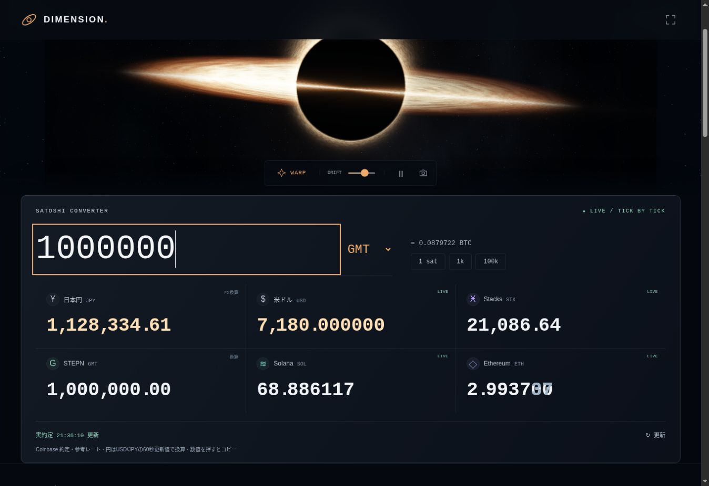

# DIMENSION

[サイトを開く](https://pythonddd.github.io/dimension/) · [English](README.md)

Bitcoin、漂うブラックホール、4つのゲームを1ページにまとめたサイトです。タブやゲーム用ダイアログを使わず、その場で操作できます。



## 主な機能

- **Satoshiコンバーター**：1 satからJPY・USD・STX・GMT・SOL・ETHを同時に換算。入力欄を広げ、長い数字は幅に合わせて文字サイズを調整します。換算結果も大きな桁送り表示のまま、幅からはみ出さないように調整。逆換算、プリセット、コピー、更新に対応します。
- **Event horizon**：降着円盤、重力レンズをイメージした光の弧、暗い中心、揺らぐ光とゆっくり漂うカメラ。ワープ、動きの停止、PNG保存、宇宙だけを眺めるモードを備え、新しいBitcoinブロックで光が変化します。
- **BTC/USDチャート**：TradingView Lightweight Charts 5.2.1とCoinbase現物データ。1分・5分・15分・1時間・6時間・日足、拡大縮小、ドラッグ移動、十字カーソル、四本値、出来高、表示範囲リセット、ページ内拡大に対応。実約定で価格を更新し、取引所の四本値・出来高を60秒ごとに同期します。時刻は日本時間です。
- **Mempool**：採掘済み4ブロックと承認待ち4予測ブロックを表示。取引数、手数料範囲・中央値・合計、サイズ、採掘プールを実データから表示します。mempool.spaceのWebSocketで更新し、60秒ごとにも同期。クリックするとmempool.spaceを別タブで開きます。採掘済みは該当ブロックのページ、承認待ちはトップページに移動し、ページ内の詳細も更新します。承認待ちの順番・時間は予測です。
- **Fee radar**：推奨手数料と取引サイズに応じたsats・日本円の概算。
- **Hash art**：旧Hash canvas。文字やブロックハッシュを模様にする画像メーカーで、PNG保存できます。相場分析や送金の機能ではありません。文字の処理は端末内で完結します。

## 4つのゲーム

| ゲーム | 遊び方 |
| --- | --- |
| Hash Echo | 光った順を再現する12ラウンドの記憶ゲーム。以前の最高得点も引き継ぎます。 |
| Bitcoin Tetris | 7種類のブロック、落下位置のガイド、ホールド、次のブロック、ライン消去、コンボ、速度上昇。矢印キー・Z・C・Space・Pと画面のボタンで操作できます。 |
| Block Breaker | パドルでボールを跳ね返すブロック崩し。3ライフ、レベル進行、コンボ、パドル拡大。 |
| Chain Match | 隣同士を入れ替えて同じコインを3つ揃えるパズル。20手、連鎖、ヒント、詰み時の盤面再生成。 |

スコアはゲーム内だけのポイントで、最高得点をこの端末に保存します。進行するゲームは画面外・フォーカス喪失・ページ非表示で一時停止し、操作で再開します。サイトは無音です。音楽・音源・音声再生・ゲームの効果音は使用しません。

Sats Merge、Block pulse、取引の横流し表示、NCS、クリプトラボ、2017タイムマシン、シーン切替タブ、各種ダイアログは削除しました。

## データと描画

Coinbaseの公開為替APIを60秒ごとに取得し、Coinbase ExchangeのWebSocketでBTC/USDと利用可能なETH・SOL・STX・GMTの実約定を受信します。新しい実約定があれば通貨間レートを再計算し、取得できないペアは定期取得値を使います。JPYはBTC/USDと60秒更新のUSD/JPYから算出します。LIVE・FX換算・換算・保存値を区別し、架空の価格変動は生成しません。

換算は参考レートです。取得失敗や150秒を超えた定期取得値を明示し、欠損をゼロで埋めません。保存値の保持は最大24時間。ページ非表示時は通信を停止します。ブロック・未承認取引・推奨手数料はmempool.spaceを参照します。

宇宙は独自のWebGLシェーダーで描画します。WebGLが使えない場合も、同じシェーダーで生成した画像をCanvasで動かします。動きの抑制設定、画面外での描画停止に対応しています。

## チャートの来歴


チャートはTradingView Lightweight Charts 5.2.1をローカル同梱。Apache-2.0のLICENSE・NOTICEと取得元・チェックサムを `assets/vendor/` に保存し、画面にも出典を表示しています。

## 開発・確認

Node 20以上。APIキー、Secrets、ウォレット接続は不要です。チャートライブラリはサイト内の静的ファイルから読み込みます。GitHub Pagesのmainブランチ直下で動きます。

```sh
npm test
npm run check
npm run build
```

自動テスト38件で換算、実レートの更新順・期限、ローソク足の検証と更新、予測ブロックの検証とWebSocket受信、ハッシュ、4ゲームを確認しています。

Chromeで1,000,000 GMTの換算、スマホ相当375 CSS px幅で19桁の入力が切れないこと、チャートの時間足切替と拡大、mempoolの実更新と選択を確認。ページ全体の横方向のはみ出しはなく、ブロック列だけを横スクロールできます。

スマホ実機のタッチとGPU動作は未確認です。
