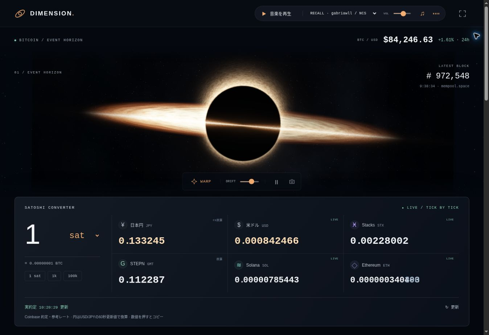

# DIMENSION

[サイトを開く](https://pythonddd.github.io/dimension/) · [English](README.md)

Bitcoin、漂うブラックホール、NCS音楽、4つのゲームを1ページにまとめたサイトです。タブやゲーム用ダイアログを使わず、その場で操作できます。



## 主な機能

- **Satoshiコンバーター**：1 satからJPY・USD・STX・GMT・SOL・ETHを同時に換算。数字を大きくし、実際のレート変化に合わせて桁が回転します。BTCを含む逆換算、プリセット、コピー、更新にも対応。スマホは1列で32〜36 pxの金額を表示します。
- **Event horizon**：降着円盤、重力レンズをイメージした光の弧、暗い中心、揺らぐ光とゆっくり漂うカメラ。ワープ、動きの停止、PNG保存、宇宙だけを眺めるモードを備え、新しいBitcoinブロックで光が変化します。
- **音楽**：Gabriawll「Recall」をNCS公式SoundCloudプレーヤーでページ内再生。上部に再生・停止・音量操作を配置しました。手元の音声ファイルも選べます。ファイルはアップロードせず端末内で再生します。再生はクリックで開始し、ページ非表示時に停止します。
- **Block pulse / Fee radar**：最新ブロック、未承認取引、手数料と日本円の概算を表示します。
- **Hash canvas**：ブロックハッシュや入力文字のSHA-256から幾何学模様を作り、PNGで保存。文字の処理は端末内で完結します。

## 4つのゲーム

| ゲーム | 遊び方 |
| --- | --- |
| Hash Echo | 光った順を再現する12ラウンドの記憶ゲーム。以前の最高得点も引き継ぎます。 |
| Bitcoin Tetris | 7種類のブロック、落下位置のガイド、ホールド、次のブロック、ライン消去、コンボ、速度上昇。矢印キー・Z・C・Space・Pと画面のボタンで操作できます。 |
| Block Breaker | パドルでボールを跳ね返すブロック崩し。3ライフ、レベル進行、コンボ、パドル拡大。 |
| Chain Match | 隣同士を入れ替えて同じコインを3つ揃えるパズル。20手、連鎖、ヒント、詰み時の盤面再生成。 |

スコアはゲーム内だけのポイントで、最高得点をこの端末に保存します。進行するゲームは画面外・フォーカス喪失・ページ非表示で一時停止し、操作で再開します。Hash Echoの音は音楽と独立して使え、チェックボックスで切れます。記憶ゲーム中は音楽の音量を下げます。

Sats Merge、クリプトラボ、2017タイムマシン、シーン切替タブ、各種ダイアログは削除しました。

## データと描画

Coinbaseの公開為替APIを60秒ごとに取得し、Coinbase ExchangeのWebSocketでBTC/USDと利用可能なETH・SOL・STX・GMTの実約定を受信します。新しい実約定があれば通貨間レートを再計算し、取得できないペアは定期取得値を使います。JPYはBTC/USDと60秒更新のUSD/JPYから算出します。LIVE・FX換算・換算・保存値を区別し、架空の価格変動は生成しません。

換算は参考レートです。取得失敗や150秒を超えた定期取得値を明示し、欠損をゼロで埋めません。保存値の保持は最大24時間。ページ非表示時は通信を停止します。ブロック・未承認取引・推奨手数料はmempool.spaceを参照します。

宇宙は独自のWebGLシェーダーで描画します。WebGLが使えない場合も、同じシェーダーで生成した画像をCanvasで動かします。動きの抑制設定、画面外での描画停止に対応しています。

## 音楽クレジット

**Gabriawll — Recall [NCS Release]**。Music provided by NoCopyrightSounds.

- [公式曲ページ・ダウンロード](https://ncs.io/Recall)
- [公式SoundCloud](https://soundcloud.com/nocopyrightsounds/gabriawll-recall-ncs-release)
- [NCS利用条件](https://ncs.io/usage-policy)

NCSでは動画制作者向け利用とゲームへの音源組み込みを区別しています。このリポジトリではMP3を再配布せず、公式ストリームの埋め込みと端末内再生を用意しています。音源の再配布・同梱には別途適用条件の確認が必要です。

## 開発・確認

Node 20以上。APIキー、Secrets、ウォレット接続は不要です。音楽利用時にSoundCloud公式ウィジェットを読み込みます。GitHub Pagesのmainブランチ直下で動きます。

```sh
npm test
npm run check
npm run build
```

自動テスト37件で換算、実レートの更新順・期限、ハッシュ、4ゲーム、音楽の状態管理を確認。テトリスではブロックの配分、移動、回転、ホールド、ライン消去、得点、接地猶予、停止、ゲームオーバーを検証しています。

Chromeで実際のWebSocketレート、桁送り表示、逆換算、NCS公式プレーヤーの再生状態、ローカルMP3再生、テトリスの主要操作を確認しました。デスクトップとスマホ相当の375 CSS px幅に横方向のはみ出しはありません。ブラウザの宇宙描画はCanvasフォールバックで確認し、WebGLシェーダーは別途ネイティブEGL/GLES環境でコンパイル・描画しています。

実機での聴感・音声出力、スマホ実機のタッチとGPU動作は未確認です。
